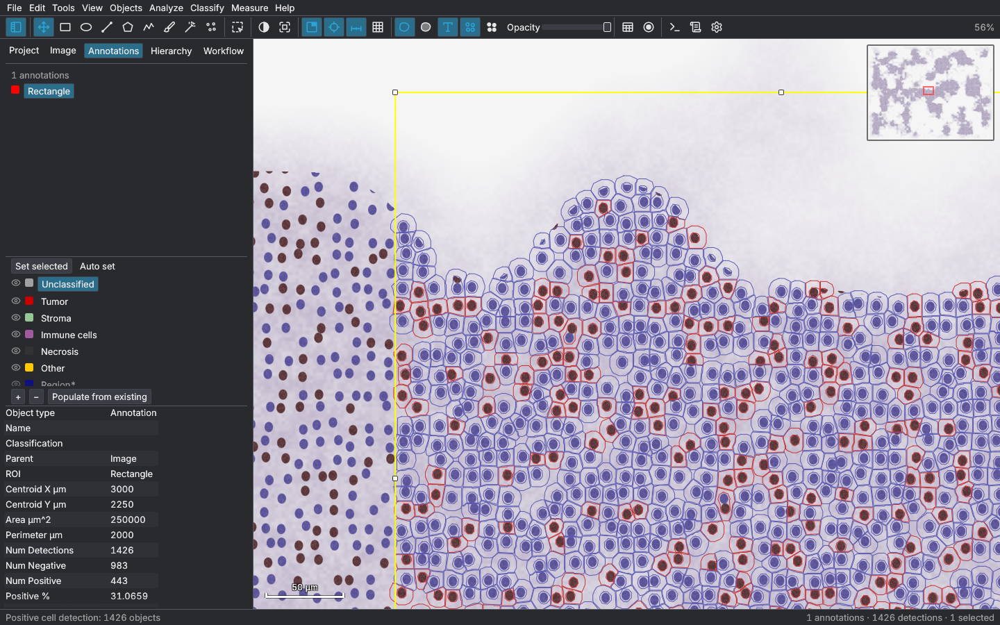

# qupath-rs

> **About this directory.** It is an independent, experimental reimplementation of
> QuPath's interface in Rust, kept in a personal fork of
> [qupath/qupath](https://github.com/qupath/qupath). It is **not affiliated with
> or endorsed by the QuPath team**. Its code was written with generative AI
> (Claude), and QuPath's [AI policy](../AI_POLICY.md) does not accept AI-generated
> contributions, so it is **not intended to be submitted upstream**.

The core of [QuPath](https://qupath.github.io), the open-source platform for
digital pathology and whole-slide image analysis, rebuilt in Rust with
[egui](https://www.egui.rs) and [fastframe](https://fastframe.dev).



It reads QuPath's file formats, so the two applications can share work:

- **Projects** (`project.qpproj`, `classifiers/classes.json`). QuPath 0.7.0 opens projects written here, and this app opens QuPath projects.
- **Objects** as QuPath-flavoured GeoJSON: annotations, detections, cells with nuclei, classes, measurements and nested children. Objects written here import into QuPath 0.7.0 unchanged, and the reverse also works.
- **Images.** It reads SVS, OME-TIFF and tiled TIFF in pure Rust. Vendor formats (NDPI, MRXS, SCN, BIF, VMS…) go through OpenSlide, which is loaded at runtime from Homebrew, from `QUPATH_RS_OPENSLIDE`, or straight out of an installed QuPath app. It writes pyramidal OME-TIFF that Bio-Formats and QuPath read.
- **Scripts.** Every command records the equivalent QuPath Groovy line in the Workflow tab, e.g. `runPlugin('qupath.imagej.detect.cells.PositiveCellDetection', '{…}')`.

## Features

| Area | What works |
| --- | --- |
| Viewer | Multi-resolution tiled rendering on worker threads, overview, scale bar, cursor location with pixel values, counting grid, wheel/trackpad/pinch/keyboard navigation |
| Tools | Move (pan, select, move, resize/vertex handles), Rectangle, Ellipse, Line, Polygon (click or freehand), Polyline, Brush, Wand, Points; selection mode; QuPath shortcuts (M R O L P V B W . ⇧S) |
| Objects | Hierarchy with QuPath's containment rules, classes with QuPath default colours, lock/unlock, merge, subtract, make inverse, expand, simplify, split, duplicate, specify annotation, full-image annotation, undo/redo |
| Analysis | Cell detection and positive cell detection (port of `WatershedCellDetection`: colour deconvolution, background subtraction, watershed, cell expansion, QuPath-named measurements), Create tiles, Create thresholder (tissue detection) |
| Display | Image types (H&E, H-DAB, fluorescence…), stain vectors, Brightness/Contrast with histogram, channel selection, deconvolved stain channels, gamma |
| Measure | Annotation/detection measurement tables (sortable, virtualized), TSV/CSV export, QuPath column names (`Area µm^2`, `Num Positive`, `Positive %`…) |
| Projects | Create/open, add images with thumbnails, filter, rename, remove, per-image data saved in the project |
| Export | OME-TIFF (pyramidal), PNG, JPEG (original or rendered), GeoJSON, viewer snapshot |
| Interface | Menus, toolbar, analysis pane (Project/Image/Annotations/Hierarchy/Workflow), command list (⌘L), preferences, log viewer, light/dark/palette themes |

**fastframe** provides the platform layer: Inter or the system font with
fallbacks for every script (`fastframe-fonts`), desktop text rendering
(`fastframe-text`), embedded SVG icons (`fastframe-icons`), colour palettes
(`fastframe-theme`), the run log and panic log (`fastframe-log`), and atomic
off-thread saves (`fastframe-file`).

See [docs/ARCHITECTURE.md](docs/ARCHITECTURE.md) for the design and for a
feature-by-feature comparison with QuPath.

## Build and run

Requires Rust 1.98+.

```bash
cargo run --release -- path/to/slide.svs
```

The command-line argument is optional. It can be an image, a `project.qpproj`, or a GeoJSON file to import.

```bash
scripts/bundle-macos.sh
```

That builds `dist/QuPath-rs.app`.

### A test slide

```bash
cargo run --release --bin make-test-slide -- synthetic-hdab.ome.tif
```

This writes a 24000×18000 px pyramidal OME-TIFF of procedural H-DAB tissue
(0.25 µm/px). It has a known nucleus spacing and a 30% DAB-positive fraction,
so detection results can be checked against ground truth.

## Commands

- `cargo run --release`: start the app
- `cargo build --release`: build
- `cargo test --release`: run the tests
- `cargo clippy --all-targets -- -D warnings`: lint
- `cargo fmt`: format
- `scripts/check-sizes.sh`: check the file and function size limits
- `scripts/bundle-macos.sh`: build the macOS app bundle

Run these from this `qupath-rs/` directory. To enable the pre-commit gates,
run this from the repository root:

```bash
git config core.hooksPath qupath-rs/.githooks
```

## Environment variables

See `.env.example`:

- `RUST_LOG`: log filter
- `QUPATH_RS_OPENSLIDE`: path to `libopenslide`
- `QUPATH_RS_AUTOMATION`: a script of UI steps that takes screenshots without a person at the screen, used for visual regression checks

Logs are written to `~/Library/Application Support/org.qupath-rs.qupath-rs/logs/` on macOS. View them in the app with View › Show log.

## Licence

GPL-3.0-or-later, like QuPath, whose design and algorithms this follows. If you
use QuPath's methods, please cite Bankhead et al., *Scientific Reports* (2017).
Third-party notices for fastframe (MIT) and Lucide (ISC) are in `assets/licenses/`.
